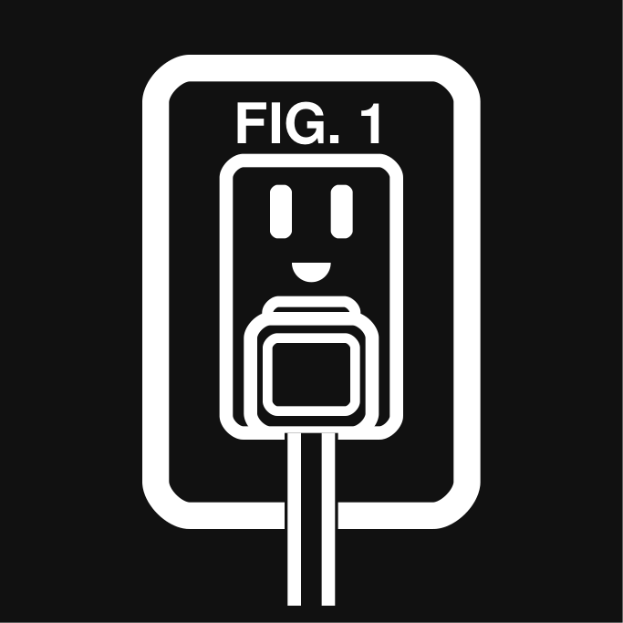
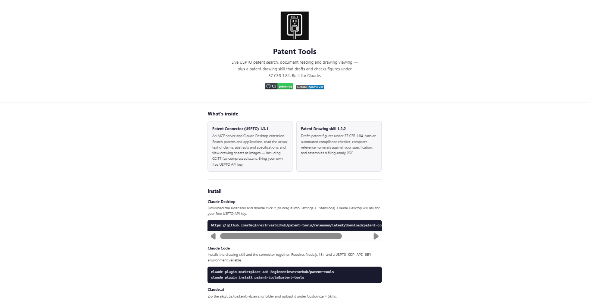

<p align="center">
  
</p>

# Patent Tools

[](https://github.com/Beginnerinvestorhub/patent-tools/actions/workflows/ci.yml)
[](LICENSE)
[](https://github.com/Beginnerinvestorhub/patent-tools/issues)

Two companion tools that give Claude patent superpowers: live access to the
USPTO Open Data Portal, and the ability to draft and check USPTO-compliant
patent drawings.

<a href="https://beginnerinvestorhub.github.io/patent-tools/"></a>

> These are research and drafting tools, not legal advice. Have a registered
> patent attorney or agent review anything before you rely on it or file.

## What's inside

Versions: Patent Connector (USPTO) 1.4.0, Patent Drawing skill 1.2.2,
plugin 1.4.0.

| Component | What it is |
|---|---|
| [`connector/`](connector/) | **Patent Connector (USPTO)** — an MCP server / Claude Desktop extension. Search USPTO patents and applications, look them up by application or patent number, read the actual text of claims, abstracts and specifications, and view the drawing sheets as images, using your own free USPTO API key. |
| [`skills/patent-drawing/`](skills/patent-drawing/) | **Patent Drawing skill** — drafts patent figures under 37 CFR 1.84, runs an automated compliance checker, compares reference numerals against your specification, and assembles a filing-ready PDF. |

## Install

Pick the channel you use:

* **Claude Desktop.** Download
  [patent-connector-1.4.0.mcpb](https://github.com/Beginnerinvestorhub/patent-tools/releases/latest/download/patent-connector-1.4.0.mcpb)
  from the latest release, then double click it (or drag it
  into **Settings > Extensions**). See
  [connector/README.md](connector/README.md) for setup and your API key.
* **Claude.ai.** Zip the `skills/patent-drawing` folder and upload it under
  **Customize > Skills**. See
  [skills/patent-drawing/README.md](skills/patent-drawing/README.md).
* **Claude Code.** Install the whole repo as a plugin — the
  `.claude-plugin/` manifest also wires up the Patent Connector MCP
  server (requires `node` and your free USPTO ODP API key, which Claude
  Code asks for when you enable the plugin):

  ```
  claude plugin marketplace add Beginnerinvestorhub/patent-tools
  claude plugin install patent-tools@patent-tools
  ```

  The marketplace installs the plugin from the `release` branch, a copy
  of `main` that CI builds after every green run. It leaves out tests,
  fixtures, build scripts and the project site, so only what the plugin
  runs is installed. The list of what it leaves out is
  [.github/release_exclude.txt](.github/release_exclude.txt).

  Or copy just `skills/patent-drawing/` into `~/.claude/skills/`
  (all projects) or `.claude/skills/` (one project). The plugin starts
  `connector/index.js` directly. The server has no dependencies, so no
  `npm install` or build step is needed. Enter your key when Claude Code
  prompts for it (stored in secure storage). See
  [Set your USPTO API key](#set-your-uspto-api-key).
* **Devin CLI / Desktop / cloud.** `devin plugins install
  Beginnerinvestorhub/patent-tools`. Installs the skill and the connector
  MCP server together.

## Set your USPTO API key

The connector needs your own free key from
[data.uspto.gov](https://data.uspto.gov) (sign in, then **My ODP**).

* **Claude Desktop extension (`.mcpb`):** Claude Desktop asks for the key
  when you install it and keeps it in the extension's settings. Nothing
  else to do.
* **Claude Code plugin (`.mcp.json`):** when the plugin is enabled,
  Claude Code prompts for the key (the sensitive `uspto_odp_api_key`
  option) and stores it in secure storage. You can change it later via
  the plugin's configure options. Nothing else to do.
* **Other hosts (Devin, a hand written MCP config):** these pass the key
  through the `USPTO_ODP_API_KEY` environment variable. See
  [docs/OTHER_HOSTS.md](docs/OTHER_HOSTS.md).

## Example prompts

* "Search for prior art on partitioned read and write authority for data
  isolation, filed before March 2024."
* "Show me the drawings of patent 12,399,789."
* "Read the claims of US 12,399,789 B1 and compare claim 1 to my invention."
* "Draw FIG. 1 for my application as a block diagram that meets 37 CFR 1.84."

## Repository layout

```
.claude-plugin/plugin.json   Plugin manifest (works in Devin and Claude Code)
.claude-plugin/marketplace.json  Marketplace entry for `claude plugin marketplace add`
.mcp.json                    Plugin-provided Patent Connector MCP server
.github/workflows/ci.yml     Offline tests on every push and pull request
.github/workflows/release.yml  Builds the slim `release` branch the plugin installs from
.github/release_exclude.txt  Paths left out of the `release` branch
docs/OTHER_HOSTS.md          API key setup for Devin and hand written MCP configs
connector/                   Patent Connector (USPTO) MCP server + .mcpb source
skills/patent-drawing/       Patent Drawing skill (self-contained; zip this
                             folder for Claude.ai or copy it for Claude Code)
```

Each component keeps its own README, CHANGELOG, LICENSE and NOTICE, so the
skill folder and the connector folder are each distributable on their own.

## Development

```
cd connector
npm ci                                # test client only; the server has no dependencies
npm run test:offline                  # security, retry and feature tests (no key)
node --env-file=../.env test/smoke.mjs   # live test suite (needs a free key)
npm run check:start                   # server starts on its own and lists all tools
npm run pack                          # rebuilds ../patent-connector-1.4.0.mcpb

cd ../skills/patent-drawing
pip install -r scripts/requirements.txt   # only the PDF builder needs packages
python tests/run_script_tests.py      # automated script tests
```

The plugin, the desktop extension and `npx patent-connector` all run
`connector/index.js` as is. There is no build step and nothing to rebuild.
See [connector/README.md](connector/README.md#no-dependencies).

To see exactly what the Claude Code plugin will install, build the release
tree locally: `.github/scripts/build_release.sh /tmp/patent-tools-release`.

## Security and privacy

The connector sends your API key and queries only to api.uspto.gov over
HTTPS; it collects nothing and has no servers. The skill's scripts run
locally with no network access. See [connector/SECURITY.md](connector/SECURITY.md),
[connector/PRIVACY.md](connector/PRIVACY.md) and
[skills/patent-drawing/SECURITY.md](skills/patent-drawing/SECURITY.md).

## Project standards

- [Contributing guide](CONTRIBUTING.md)
- [Code of conduct](CODE_OF_CONDUCT.md)
- [Security policy](SECURITY.md)
- [Privacy policy](PRIVACY.md)
- [Changelog](CHANGELOG.md)
- [Issue templates](.github/ISSUE_TEMPLATE)
- [Pull request template](.github/pull_request_template.md)

## License

Copyright 2026 Kevin Ringler. Licensed under the Apache License, Version
2.0; see LICENSE and NOTICE.
